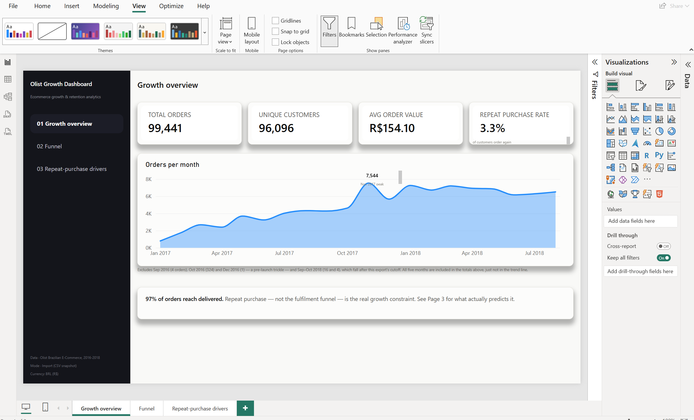
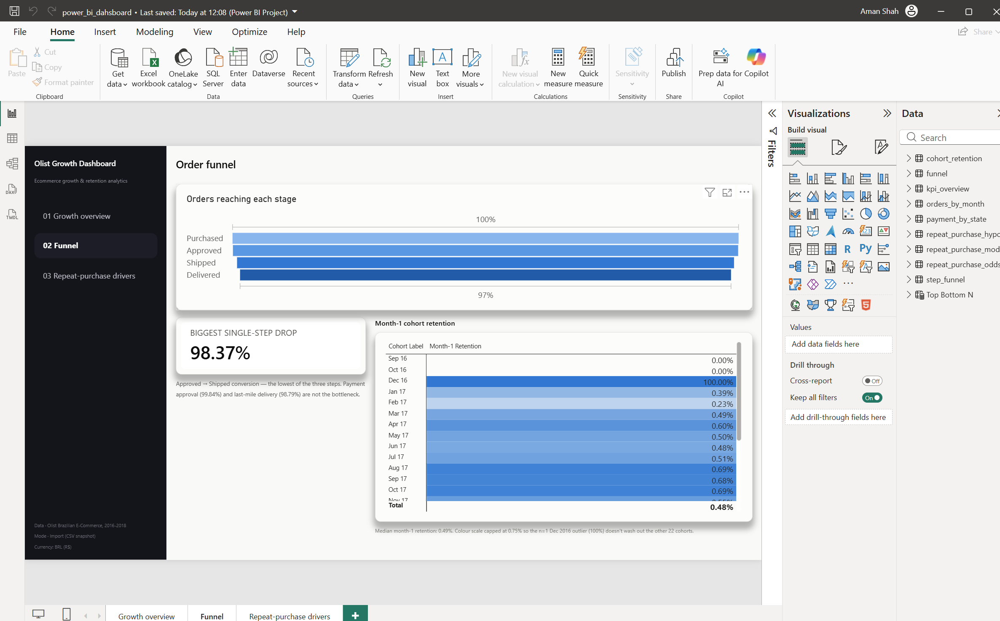
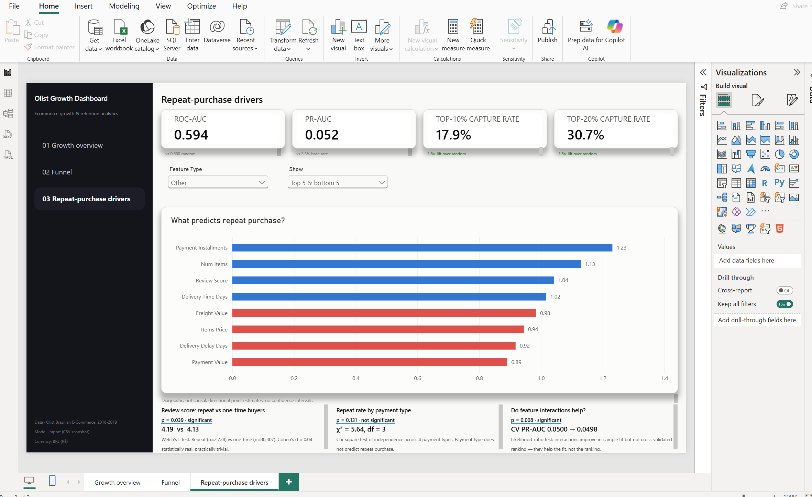

# Ecommerce Growth Diagnostics

An analysis of ~100k orders from a Brazilian online marketplace, looking at where the business loses
customers and whether anything about a customer's first order predicts that they'll come back.

## Questions

1. **Funnel** – What share of orders makes it from purchased to approved to shipped to delivered,
   and which step loses the most?
2. **Cohort retention** – Of the customers who first ordered in a given month, how many come back
   for a second order?
3. **Regions** – How do order value and payment installments differ by region, and where does high
   volume not mean high value?
4. **Repeat-purchase drivers** – Using only what's known at the first order (review, delivery,
   payment, product, location), what predicts a second order?

Questions 1–3 are answered in [`notebooks/analysis.ipynb`](notebooks/analysis.ipynb), each with a SQL
query, a chart and a short write-up. Question 4 has its own notebook
([`repeat_purchase_eda.ipynb`](notebooks/repeat_purchase_eda.ipynb)) and script
([`src/repeat_purchase_analysis.py`](src/repeat_purchase_analysis.py)).

## Headline findings

- **The funnel is healthy.** 97% of orders reach "delivered". The biggest drop is between
  *approved* and *shipped*, not at payment or delivery.
- **Retention is the real problem.** Month-1 retention is under 1% almost everywhere, with no
  improvement over time.
- **Volume and value pull in opposite directions by region.** The highest-volume region has the
  lowest average order value. Distant, low-volume regions pay the most, probably because freight is
  included in the payment value.
- **Repeat purchase is rare and hard to predict.** Only 3.3% of 83,644 first-time customers order
  again, and the model can only weakly separate them from the rest.
- **What and where matter more than how the first order went.** Review score, delivery time and
  order value barely differ between repeaters and one-time buyers. The strongest signals are
  product category (fashion accessories, bed/bath and furniture first orders repeat roughly
  1.5–2.3x more than electronics) and region.
- **Extra modelling steps didn't help.** Interaction terms improved the fit statistically but not
  the cross-validated score, so I kept the simpler model. Geographic features (distance between
  customer and seller, same state, seller density) have a small real effect but don't improve the
  headline metrics. Distance is mostly the same information the customer's state already carried.

## Model result

| Metric | Model | 95% CI | Baseline |
|---|---|---|---|
| ROC-AUC | 0.59 | [0.57, 0.62] | 0.50 (random) |
| PR-AUC | 0.052 | [0.044, 0.064] | 0.033 (base rate) |
| Top 10% of customers | catches 16.8% of repeaters (1.7x lift) | [13.9%, 20.0%] | 10% |
| Top 20% of customers | catches 30.5% of repeaters | [26.8%, 34.1%] | 20% |

This is not a reliable yes/no classifier, but it is useful for ranking: if you can only target a
slice of customers, the top-scored ones are noticeably more likely to return than random picks. The
confidence intervals come from resampling the test set 1,000 times. They show the edge over random
is real and not luck of the split.

## Data

[Olist Brazilian E-Commerce dataset](https://www.kaggle.com/datasets/olistbr/brazilian-ecommerce):
real orders from 2016–2018 across 8 tables (orders, items, payments, customers, reviews, products,
geolocation, sellers).

## How to run

Tested on a fresh install with Python 3.13.

```bash
python -m venv .venv
source .venv/bin/activate          # Windows: .venv\Scripts\activate
pip install -r requirements.txt
```

1. Download the [Olist dataset from Kaggle](https://www.kaggle.com/datasets/olistbr/brazilian-ecommerce)
   and unzip the CSVs into `data/raw/` (the data is not committed to this repo).
2. Build the database and run the checks:

```bash
python src/etl.py                         # raw CSVs -> data/olist.db
python -m pytest tests/ -q                # 36 tests (skipped, not failed, if the data is missing)
python src/repeat_purchase_analysis.py    # hypothesis tests, model, confidence intervals, dashboard exports (~1 min)
```

The notebooks in `notebooks/` read from `data/olist.db`, so run the ETL step first. The t-SNE
plot in `segmentation.ipynb` takes several minutes on the full customer set.

## How it's built

1. **ETL** ([`src/etl.py`](src/etl.py)) – Loads the CSVs into a local SQLite database with light
   cleaning and indexes on the join columns. It does not fill in missing values, because that
   choice should be made later, once the data has been explored.
2. **SQL queries** ([`queries/`](queries)) – One file per question, plus the feature set for the
   model. The features come from each customer's *first order only*, since using later orders would
   leak the answer. Customers whose first order was in the last 3 months of the data are dropped,
   because they haven't had time to come back yet. Review scores only count if the review arrived
   within 30 days of delivery, so whether a score is missing doesn't depend on whether the customer
   returned.
3. **Analysis notebook** ([`notebooks/analysis.ipynb`](notebooks/analysis.ipynb)) – Runs the
   queries, charts the results and writes up the findings.
4. **EDA** ([`notebooks/repeat_purchase_eda.ipynb`](notebooks/repeat_purchase_eda.ipynb)) – Checks
   class balance, missing values, correlated features and whether the 3-month cutoff worked, before
   any modelling choices are made. A separate notebook
   ([`geolocation_analysis.ipynb`](notebooks/geolocation_analysis.ipynb)) covers the geographic
   features.
5. **Model** ([`src/repeat_purchase_analysis.py`](src/repeat_purchase_analysis.py)) – Hypothesis
   tests plus a logistic regression. I chose logistic regression because the goal is to understand
   the drivers, and its odds ratios are easy to read. Because so few customers repeat, the model
   weights the rare class more heavily. It's evaluated with 5-fold cross-validation and a final
   held-out test set. Every run is logged to MLflow with the git commit and feature set, so any
   number can be traced to the code that produced it. Results are also written back to the database
   and to `Dashboard/exports/*.csv` for the dashboard.
6. **Confidence intervals** ([`src/confidence_interval.py`](src/confidence_interval.py)) – The
   deployed model is regularised and class-weighted, which means its coefficients don't have simple
   standard errors. So the odds-ratio intervals come from a second, plain `statsmodels` logistic
   regression fit on the same data, used only for inference. The metric intervals (ROC-AUC and so
   on) use a bootstrap, since those have no formula.
7. **Dashboard** ([`Dashboard/projects/power_bi_dahsboard.pbip`](Dashboard/projects/power_bi_dahsboard.pbip))
   – A Power BI report built from the exported CSVs, with three pages. Opening it needs Power BI
   Desktop; there's also a [browser version](https://claude.ai/artifact/ULMkaLkcgrCmd6pFdqADDu).

   **Growth overview** – orders, customers, average order value, repeat rate, orders per month.
   

   **Funnel** – order conversion by stage and month-1 cohort retention.
   

   **Repeat-purchase drivers** – the model's odds ratios and the two hypothesis tests.
   
8. **Tests** ([`tests/`](tests)) – Data-quality checks on the ETL output and sanity checks on the
   model's feature query, including the 3-month cutoff and the 30-day review rule.
